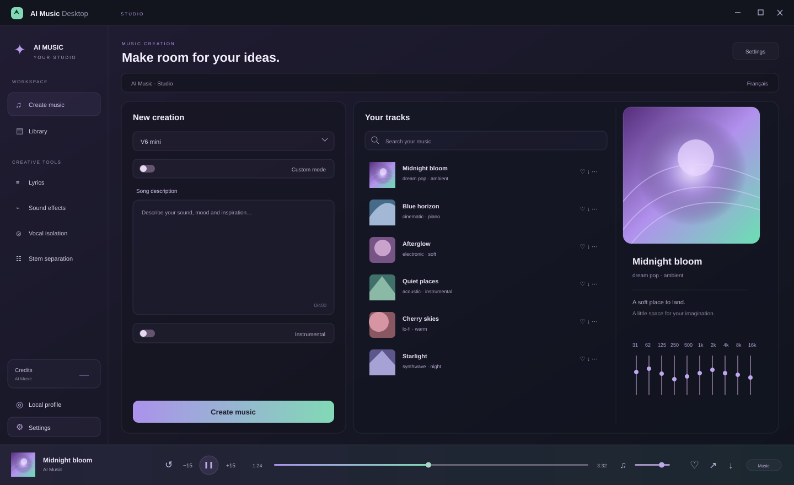

<p align="center"></p>

<h1 align="center">AI Music Desktop</h1>
<p align="center"><strong>Musika mo. Studio mo.</strong></p>
<p align="center">Isang Windows space para lumikha gamit ang AI Music, makinig sa mga kanta at hubugin ang tunog mo.</p>

<p align="center">
  <a href="https://hanacherry.github.io/aimusic-desktop/?lang=tl"></a>
  <a href="https://github.com/HanaCherry/aimusic-desktop/releases/tag/v0.4.0"></a>
  <a href="package.json"></a>
</p>

<p align="center"><a href="https://github.com/HanaCherry/aimusic-desktop/releases/download/v0.4.0/AI-Music-Desktop-0.4.0-Installation.exe"><strong>I-download para sa Windows</strong></a> · <a href="https://hanacherry.github.io/aimusic-desktop/?lang=tl">Studio na bagay sa iyo</a> · <a href="https://github.com/HanaCherry/aimusic-desktop">Tingnan ang code</a></p>

<details>
<summary align="center">🌐 Filipino · 32 languages</summary>
<p align="center">
<a href="README.md" lang="fr">Français</a> ·
<a href="README.en.md" lang="en">English</a> ·
<a href="README.es.md" lang="es">Español</a> ·
<a href="README.pt.md" lang="pt">Português</a> ·
<a href="README.de.md" lang="de">Deutsch</a> ·
<a href="README.it.md" lang="it">Italiano</a> ·
<a href="README.ja.md" lang="ja">日本語</a> ·
<a href="README.ko.md" lang="ko">한국어</a> ·
<a href="README.zh.md" lang="zh">简体中文</a> ·
<a href="README.zh-TW.md" lang="zh-TW">繁體中文</a> ·
<a href="README.ar.md" lang="ar">العربية</a> ·
<a href="README.ru.md" lang="ru">Русский</a> ·
<a href="README.hi.md" lang="hi">हिन्दी</a> ·
<a href="README.tr.md" lang="tr">Türkçe</a> ·
<a href="README.pl.md" lang="pl">Polski</a> ·
<a href="README.nl.md" lang="nl">Nederlands</a> ·
<a href="README.id.md" lang="id">Bahasa Indonesia</a> ·
<a href="README.vi.md" lang="vi">Tiếng Việt</a> ·
<a href="README.th.md" lang="th">ไทย</a> ·
<a href="README.uk.md" lang="uk">Українська</a> ·
<a href="README.sv.md" lang="sv">Svenska</a> ·
<a href="README.cs.md" lang="cs">Čeština</a> ·
<a href="README.ro.md" lang="ro">Română</a> ·
<a href="README.el.md" lang="el">Ελληνικά</a> ·
<a href="README.hu.md" lang="hu">Magyar</a> ·
<a href="README.fi.md" lang="fi">Suomi</a> ·
<a href="README.da.md" lang="da">Dansk</a> ·
<a href="README.no.md" lang="no">Norsk</a> ·
<a href="README.he.md" lang="he">עברית</a> ·
<a href="README.ca.md" lang="ca">Català</a> ·
<a href="README.ms.md" lang="ms">Bahasa Melayu</a> ·
<a href="README.tl.md" lang="tl">Filipino</a>
</p>
</details>

<p align="center"></p>
<p align="center"><sub>Ilustrasyon ng interface na walang data ng account.</sub></p>

## Studio na bagay sa iyo

- **Pinagsamang player** — Nakapirming cover, transparent na bar, makulay na progress at playback controls sa ibaba.

- **Kulay at atmospera** — Galaxy, Musika, Gabi, Maliwanag at Opisyal. Kasama sa pakikinig ang mga kulay ng album cover.

- **Equalizer at effects** — Sampung band, preamp, preset, A/B, stereo width, pan, auto-pan, reverb, echo at spectrum.

- **Lokal na profile** — Magdagdag ng larawan at palayaw. Nananatili sa computer ang mga setting at audio preset.

- **Cache sa pagsisimula** — Ginagamit muli ng disk cache ang mga available na resource. Pinananatili ng pag-clear ang session at mga setting.

- **Nakikitang credits** — Tingnan ang balanse ng AI Music at gamitin ang tunay na mga tool ng serbisyo.

## Handa nang buksan ang studio?

1. I-download ang Windows installer mula sa release. → [v0.4.0](https://github.com/HanaCherry/aimusic-desktop/releases/tag/v0.4.0)
2. Patakbuhin ang .exe file at sundin ang pag-install.
3. Buksan ang AI Music Desktop at mag-sign in kung kailangan.

> Walang digital signature ang installer; maaaring magpakita ng babala ang Windows.

## Isang malayang proyekto

Hindi opisyal na app at walang kaugnayan sa AI Music. Kailangan ang Internet. Nakadepende ang effects at pagsusuri sa access sa audio stream; hindi ginagarantiya ng synthetic tests ang lahat ng online na kanta.

Available ang presentasyong ito sa 32 wika. Kasalukuyang French ang lokal na interface; piliin ang wika ng serbisyo sa menu nito.

→ [NOTICE.md](NOTICE.md) · [aimusic.so](https://aimusic.so/fr/app)

## Development

Node.js 22.12+ · pnpm · Windows x64

```sh
git clone https://github.com/HanaCherry/aimusic-desktop.git
cd aimusic-desktop
pnpm install --frozen-lockfile
node node_modules/electron/install.js
pnpm start
```

```sh
pnpm test
pnpm exec electron . --smoke-test
pnpm exec electron . --preview
pnpm dist
```

---

<p align="center">AI Music Desktop · 0.4.0 · <a href="https://hanacherry.github.io/aimusic-desktop/?lang=tl">Musika mo. Studio mo.</a></p>
